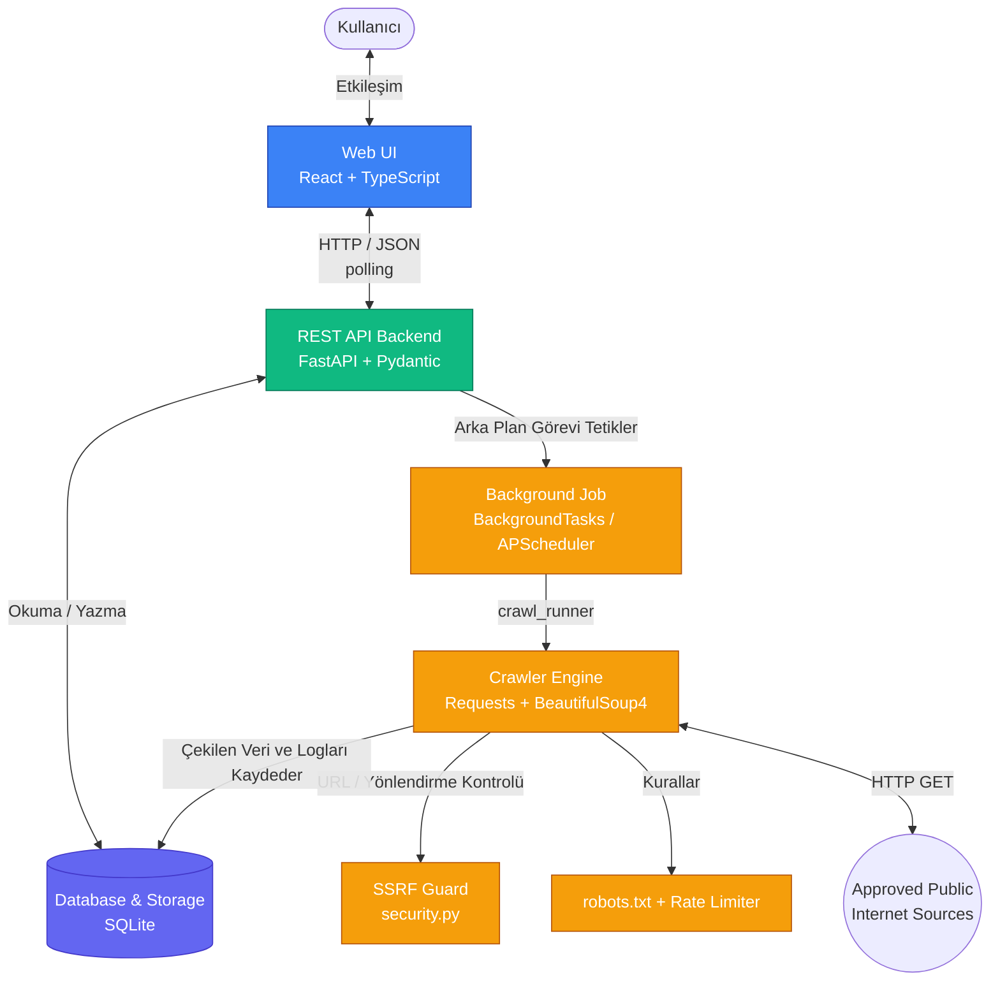

# System Architecture

Bu diyagram, OSINT Web Crawler projesinin katmanlı mimarisini ve veri akışını göstermektedir. Sistem, ön yüz ve tarayıcı motoru arasındaki iletişimin sadece REST API üzerinden yapıldığı tam yalıtımlı bir yapıda tasarlanmıştır.

## Tarama Akışı

1. Kullanıcı arayüzden kaynakları seçip taramayı başlatır → `POST /api/crawls`.
2. API isteği Pydantic ile doğrular, `crawl_jobs` tablosuna `queued` durumunda bir kayıt açar ve hemen `job_id` döner.
3. `crawl_runner.run_crawl_job` arka planda her kaynak için `CrawlerEngine` çalıştırır:
   - URL ve her yönlendirme SSRF kontrolünden geçer,
   - `robots.txt` bir kez indirilip önbelleğe alınır, kurallara ve `Crawl-delay` değerine uyulur,
   - istekler arası kaynak bazlı gecikme uygulanır, 5xx/timeout hataları sınırlı sayıda tekrar denenir, 401/403/429 tekrar denenmez,
   - sayfalar domaine uygun ayrıştırıcı ile işlenir, aynı URL tekrar ziyaret edilmez.
4. İlerleme (`progress`, `pages_visited`, `records_extracted`, `error_count`) her sayfadan sonra veritabanına yazılır; arayüz bunu `GET /api/crawls/{job_id}` ile periyodik olarak okur.
5. `POST /api/crawls/{job_id}/stop` görevi `stopping` durumuna alır; motor bir sonraki sayfadan önce bunu görüp `stopped` olarak sonlanır.
6. Toplanan kayıtlar `advisories` tablosuna yazılır (aynı URL varsa güncellenir), loglar `crawl_logs` tablosuna ve `logs/system.log` dosyasına düşer.
