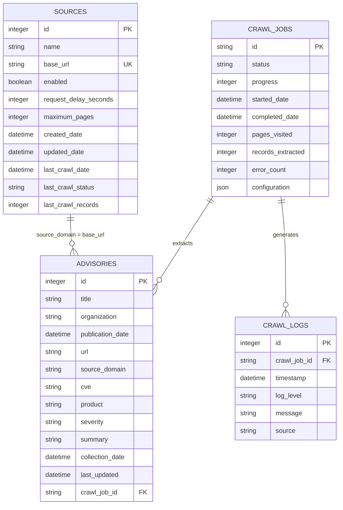

# Database Design (ER Diagram)

Projede toplanan siber istihbarat verilerini, kaynak yapılandırmalarını ve sistem loglarını kalıcı olarak saklamak için oluşturulan ilişkisel veritabanı şeması aşağıdadır.

## Notlar

- `crawl_jobs.configuration` alanı taramanın isteğini (seçilen kaynaklar, `maximum_pages`, `max_depth`, `date_from`, `keywords`) JSON olarak saklar.
- `advisories.url` mükerrer kayıt kontrolünde kullanılır; aynı URL tekrar toplandığında yeni kayıt açılmaz, mevcut kayıt ve `last_updated` güncellenir.
- Zaman damgaları UTC olarak saklanır, arayüzde kullanıcının yerel saatine çevrilir.

## Migrasyonlar

Tablolar ilk açılışta `Base.metadata.create_all()` ile oluşturulur. Mevcut veritabanlarına sonradan eklenen kolonlar `app/database/connection.py` içindeki `SCHEMA_MIGRATIONS` sözlüğü ile uygulama başlarken otomatik eklenir:

| Tablo | Kolon | Tip |
|---|---|---|
| `advisories` | `last_updated` | `DATETIME` |
| `sources` | `maximum_pages` | `INTEGER DEFAULT 100` |
| `sources` | `last_crawl_status` | `VARCHAR` |
| `sources` | `last_crawl_records` | `INTEGER` |
